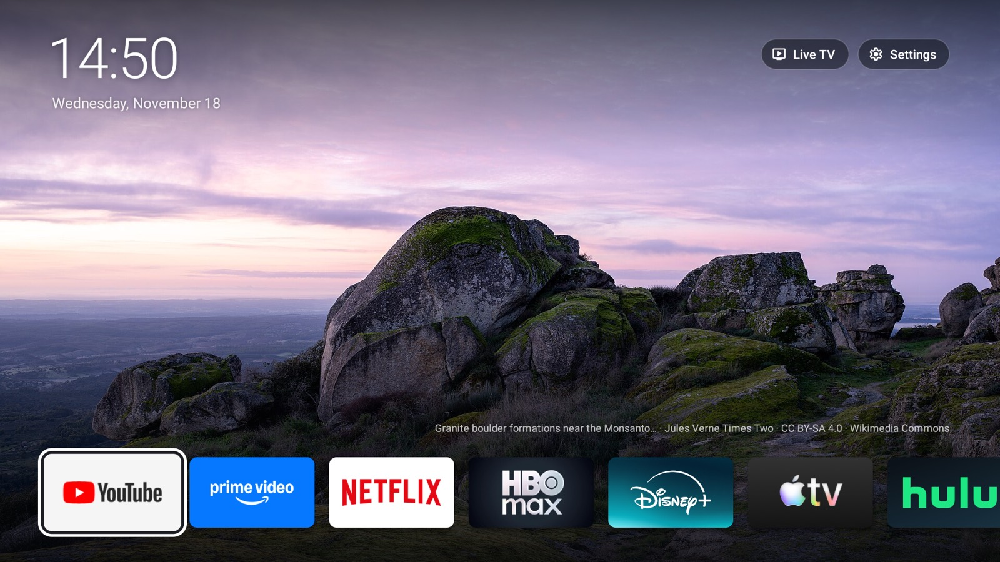
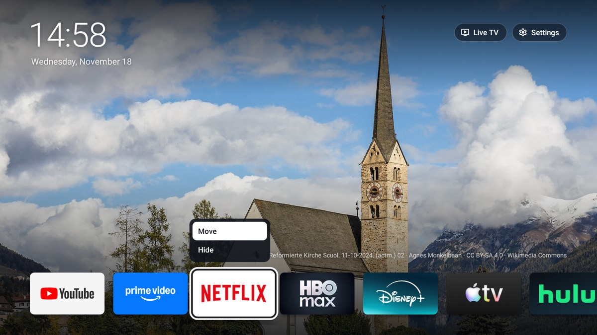
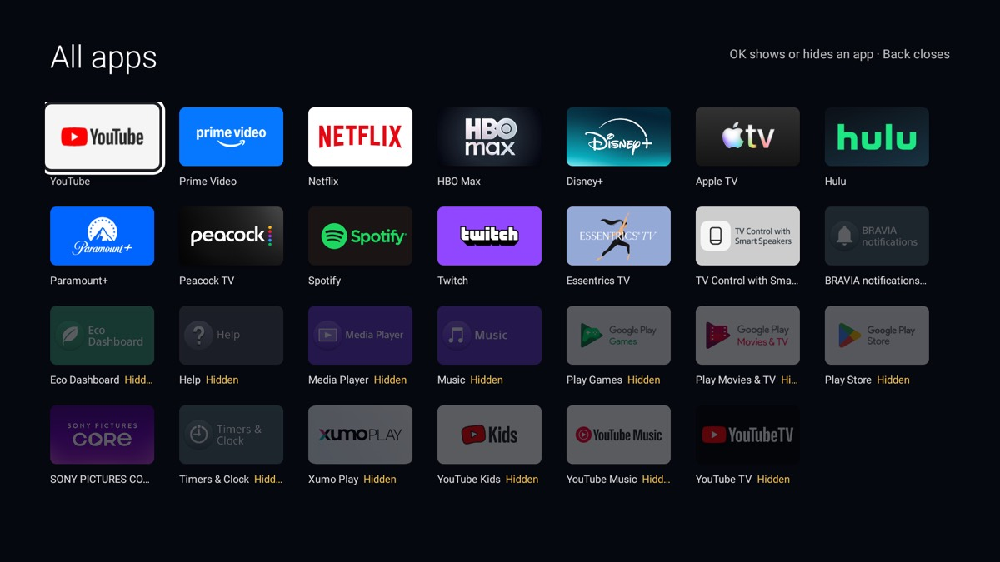

# x80k-home

A calm, ad-free home screen for the **Sony BRAVIA X80K** (2022, Google TV), plus a short, reversible list of
the tracking and bloat to switch off. No root. Nothing is uninstalled. Every change is undone with one command.



<sub>Photo: *Granite boulder formations near the Monsanto Castle at sunrise* by Jules Verne Times Two,
[CC BY-SA 4.0](https://creativecommons.org/licenses/by-sa/4.0/), via Wikimedia Commons.</sub>

## What you get

- **Frame**, a home screen that shows a new featured landscape photo from Wikimedia Commons every minute,
  your apps in one row, a 24-hour clock, Live TV, your HDMI inputs and Settings. No ads, no "for you" rows.
  Photos can be slowed down or switched off, and the screen can dim itself at night.
- **The list for your TV's platform**: on the X80K, 19 packages switched off, among them Samba TV (which identifies what's on your screen to sell
  viewing data), Sony's usage reporting and promos, store demo mode, and voice and text-to-speech.
- Kept exactly as they are: Google's Ambient Mode screensaver, Live TV and both antenna tuners, HDMI and
  HDMI-CEC, Chromecast, AirPlay, the remote's app buttons, the Play Store and firmware updates.

On our TV the home screen went from 119 MB of memory (Google TV's) to about 45 MB.

## Why you can trust it

The whole app is four Java files, under 1,000 lines, readable in an evening. `build.sh` builds it with Google's
own SDK tools (no Gradle, no downloaded libraries) and **fails the build** unless:

- the app asks for exactly one permission, internet, which it uses only for the photos;
- every web address anywhere in the app is Wikimedia's, and the download code refuses any other at run time;
- every class in the APK comes from this repo;
- the APK holds only the expected files and stays under 100 KB.

Builds are reproducible: the same source gives byte-identical output on a Mac and on GitHub's Linux runners,
and CI checks it on every push.
The app sends nothing about you: no app list, no viewing history, no identifiers. Wikimedia sees your TV's
IP address when a photo downloads, the same as visiting their website. With photos switched off, Frame never goes
online at all. [SECURITY.md](SECURITY.md) has the details and how to verify a release.

## Install

You need a Mac or Linux computer on the same network as the TV.

**On the TV:** Settings → System → About, then press OK on *Android TV OS build* 7 times. Then Settings →
System → Developer options → turn on **USB debugging**.

### Quick install: the ready-made app

1. Install Google's `adb` and get this repo for `tv.sh` and the lists:
   ```sh
   brew install --cask android-platform-tools
   git clone https://github.com/shaunak3000/x80k-home && cd x80k-home
   ```
2. Download `x80k-home-0.1.1.apk` from [Releases](https://github.com/shaunak3000/x80k-home/releases) into the
   folder, and check it:
   ```sh
   shasum -a 256 x80k-home-0.1.1.apk    # 9694bcd9910f09e9755c5b358a8b3dbf25edcc024fed465799b9778be1f3d49b
   ```
   It is signed by certificate SHA-256 `4fcf37556691af0012b8706ec13d76407d33cacc5fe23bcd42e34ff6543e60cc`.
   To prove its code is this repo's code, build it yourself (below) and compare
   `unzip -p <apk> classes.dex | shasum -a 256` for both: they match.
3. Install it:
   ```sh
   export TV=192.168.1.20                     # your TV's IP address
   ./tv.sh connect                            # then press Allow on the TV, ticking "Always allow from this computer"
   ./tv.sh install x80k-home-0.1.1.apk
   ./tv.sh home                               # Frame becomes the home screen
   ./tv.sh debloat                            # switch off the list for your TV's platform
   ./tv.sh check                              # confirm: Frame is Home, the list is off
   ```
4. Turn **USB debugging** back off. Frame and the list keep working without it.

### Build it yourself

1. Install JDK 21 and Google's Android command-line tools, then the pinned SDK packages:
   ```sh
   brew install openjdk@21 && brew install --cask android-commandlinetools
   export JAVA_HOME=$(brew --prefix openjdk@21)/libexec/openjdk.jdk/Contents/Home
   sdkmanager --sdk_root=$HOME/Library/Android/sdk "platform-tools" "build-tools;37.0.0" "platforms;android-31"
   ```
2. Build and install:
   ```sh
   git clone https://github.com/shaunak3000/x80k-home && cd x80k-home
   ./build.sh
   export TV=192.168.1.20        # your TV's IP address
   ./tv.sh connect               # then press Allow on the TV, ticking "Always allow from this computer"
   ./tv.sh install
   ./tv.sh home                  # Frame becomes the home screen
   ./tv.sh debloat               # switch off the list for your TV's platform
   ./tv.sh check                 # confirm: Frame is Home, the list is off
   ```
3. Turn **USB debugging** back off. Frame and the list keep working without it.

To choose which apps appear in the row the first time, edit `FAVORITES` in
[`Apps.java`](app/src/io/github/shaunak3000/tvhome/Apps.java) before building. After that, use the TV.

## Using Frame

- **OK** opens an app. **Hold OK** on a tile to move or hide it.
- **All apps**, the last tile, shows every app; OK shows or hides one. Newly installed apps join the end of the row.
- **Live TV** opens Sony's TV app for antenna channels. An HDMI button appears for each input that has something
  plugged in.
- **Settings**, at the top right, opens a menu: the TV's own settings, then Frame's: photos on or off, a new photo
  every 1, 5 or 15 minutes, and night dimming from 22:00 to 07:00. OK changes a setting in place.
  The remote's gear button no longer works once Google's home screen is off.

| Hold OK on a tile | All apps |
|---|---|
|  |  |

<sub>Background photo: *Reformierte Kirche Scuol* by Agnes Monkelbaan, [CC BY-SA 4.0](https://creativecommons.org/licenses/by-sa/4.0/), via Wikimedia Commons.</sub>

## Undo

```sh
./tv.sh restore    # switch the list back on
./tv.sh stock      # bring back Google TV's home screen
```

## Good to know

- **Why Google's home has to be switched off:** Google TV hands the Home button to its own home screens and
  ignores the user's choice, so `tv.sh home` switches off both of them, the stock home and the setup wizard's
  recovery screen. The setup wizard can own a Wi-Fi network saved during first setup, and switching it off
  deletes networks it owns. Check that your TV's current network wasn't saved by the setup wizard first.
- **Before any factory reset, run `./tv.sh stock`.** It turns the setup wizard back on.
- **Give changes 20 seconds before unplugging the TV.** Android saves package changes after a short delay.
- **After a firmware update**, run `./tv.sh check`. It reports anything switched back on, or Home handed back
  to Google, and names the command that fixes it.
- **The release and your own build are signed differently**, so Android won't install one over the other. To
  switch, run `./tv.sh stock`, then `adb uninstall io.github.shaunak3000.tvhome`, then install and `./tv.sh home`.
- **One known side effect:** with any package switched off, this firmware's link checker
  (`com.android.statementservice`) crashes once at start-up, silently, because it can't create its own storage folder.
  Nothing you use is affected.
- **Sony's BRAVIA Connect link stays on** on purpose: switching it off crashes Sony's system service at start-up.

## Other TVs

Lists live in `models/<platform>/`, and `tv.sh` asks the TV which platform it is. Tested on a **KD-55X80CK**
(US, Android 12): its platform, `BRAVIA_VH21`, also covers 2022 sets like the X85K and A80K, and packages a TV
doesn't have are skipped. For any other TV, `tv.sh` refuses until someone adds a list;
[CONTRIBUTING.md](CONTRIBUTING.md) explains how, including the restart test that proves a list is safe.

## Credits

- Package research for this platform: [cleanyourtv](https://github.com/Gathin23/cleanyourtv)'s VH21 lists.
- Icons: [Material Symbols](https://github.com/google/material-design-icons) by Google, Apache License 2.0.
- Photos: Wikimedia Commons featured pictures, credited on screen with each photo.

## License

[MIT](LICENSE)
